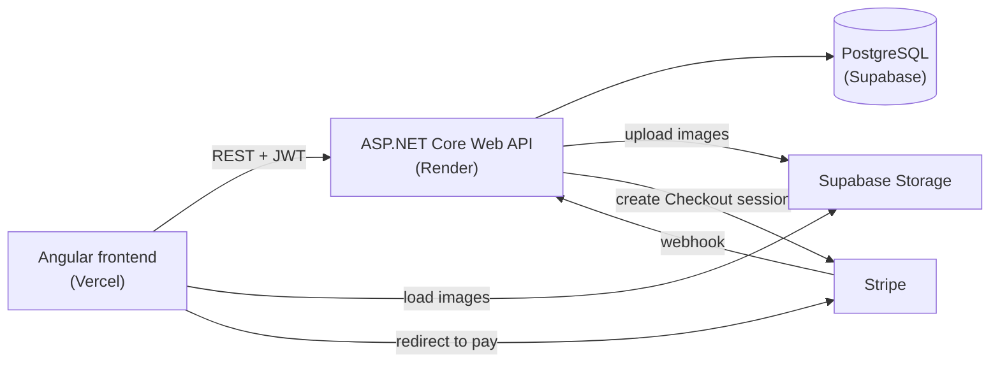
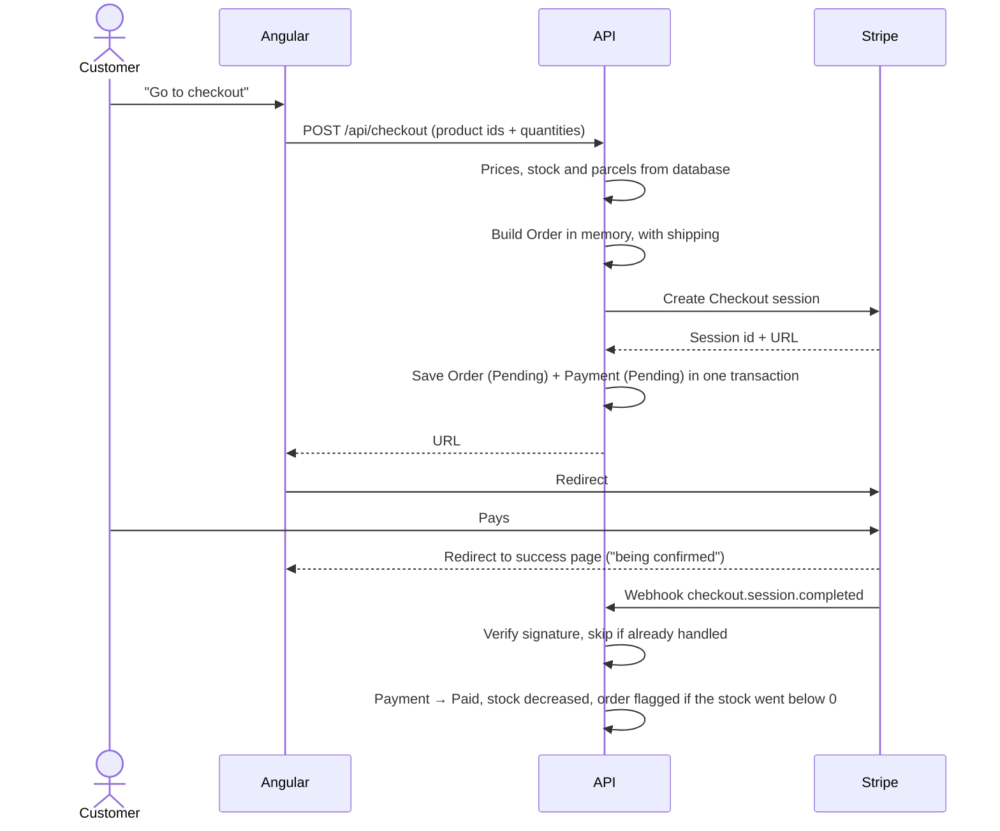
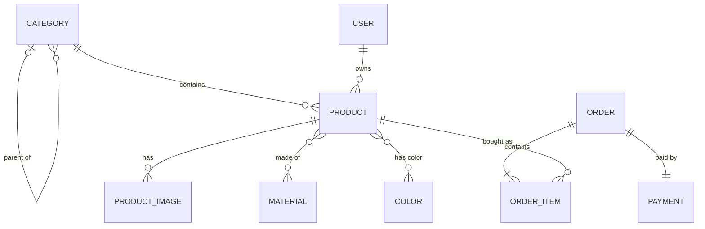

# Architecture – GREJ

How the system is built. What is built is in [scope.md](scope.md), the rules it must follow are in [constraints.md](constraints.md).

## Overview



| Part | Technology | Hosting |
|---|---|---|
| Frontend | Angular | Vercel |
| Backend | C# ASP.NET Core Web API, EF Core | Render (Docker) |
| Database | PostgreSQL | Supabase |
| Images | Supabase Storage | Supabase |
| Payments | Stripe Checkout (test mode) + webhook | Stripe |

The API runs on Render as a Docker container, since Render has no built-in .NET support. It connects to the database through Supabase's session pooler, because Render can only reach IPv4 addresses.

Local development and production use the same Supabase database and image bucket, so migrations applied locally also apply to production, and images uploaded locally are shown in production too. There is no separate production database, since everything in the shop is demo content, so `reset-demo` resets the deployed shop too (see Demo data).

## Modular monolith

The API is one application, deployed as one unit, split into modules with clear responsibilities:

| Module | Responsibility |
|---|---|
| **Catalog** | Products, categories, materials, colors, images, stock |
| **Orders** | Orders, order rows, order status |
| **Payments** | Payments, Stripe Checkout, webhook |
| **Identity** | Admin login, roles |

Modules use each other through application services, not through each other's tables or entities.

**Why:** one application is simple to deploy and debug for one developer, while the module boundaries keep the code organized and make it possible to grow or split a module later.

## Layers

Each module is split into the same layers. Dependencies only point inwards, towards the domain:

```
Api ──► Application ──► Domain
             ▲
Infrastructure
```

| Layer | Contains | Example |
|---|---|---|
| **Api** | Controllers, request/response models, authentication setup | `POST /api/checkout` |
| **Application** | Use cases and interfaces for infrastructure | "Create checkout", "Mark order as shipped", `IPaymentProvider` |
| **Domain** | Entities and business rules, no dependencies | `Order.MarkAsShipped()` refuses unless the payment is `Paid` |
| **Infrastructure** | EF Core and PostgreSQL, Stripe, Supabase Storage | `StripePaymentProvider`, `GrejDbContext` |

**Why:** the business rules do not depend on the database or Stripe, which makes them easy to test and makes it possible to replace infrastructure later.

## Solution structure

```
server/
  Grej.Api/              Controllers per module, Program.cs
  Grej.Application/      Catalog/, Orders/, Payments/, Identity/, Common/ (e.g. PagedResult)
  Grej.Domain/           Catalog/, Orders/, Payments/
  Grej.Infrastructure/   Persistence/ (DbContext, migrations, repositories), Identity/ (admin seed, login), Stripe/, Images/, DemoData/ (demo content, reset-demo)
  Grej.UnitTests/        Domain and application rules
  Grej.IntegrationTests/ API, checkout and webhook against a test database
client/
  src/styles/            Shared style variables and base styles
  src/app/
    core/                API services, auth interceptor, route guards
    shared/              Reusable components (button, icon, badge, pagination) and helpers
    features/shop/       Shop layout, start page, product list, product page, cart, checkout, success page
    features/admin/      Admin layout and menu, login, products, categories, properties, orders
```

## Key decisions

| Decision | Why |
|---|---|
| **Stripe Checkout** (Stripe's hosted payment page) | No card data passes through my system; Stripe handles card errors and retries |
| **The webhook is the source of truth** for payments; signature verified; each event handled once | The browser can be closed or manipulated; Stripe may send the same event twice |
| **Payment is its own entity** with provider and reference, behind `IPaymentProvider` | More payment methods can be added later without changing the order flow |
| **Two statuses:** payment status (set by the provider) and order status (set by the admin) | Keeps "is it paid?" and "is it shipped?" separate, e.g. shipped but refunded |
| **Prices and shipping calculated in the API** from the database; title and price stored on each order row, shipping on the order | Prices in the browser can be manipulated; old orders must not change |
| **Money as `decimal` + currency** (SEK in this version) | Floating point gives rounding errors; storing the currency keeps more currencies possible |
| **ASP.NET Core Identity + JWT**, role Admin | Frontend and API are on different domains, which makes tokens simpler than cookies |
| **Supabase for database and images** | One service I already know for both; images cannot be stored on Render, whose file system is cleared on every deploy |
| **Cart in localStorage** | Customers buy as guests, so there is no account to store the cart on |
| **`SellerId` on every product** (always the admin) | Cheap now, keeps a future marketplace possible |
| **One database** for development and the deployed shop, filled by `reset-demo` | Everything in the shop is demo content, so a second database would only add setup; the cost is that a reset or a migration reaches the deployed shop at once |

## Checkout flow



The order is saved only after Stripe has created the session, together with its rows and payment in one transaction. If Stripe does not answer, nothing is saved, so there is never an order whose payment can never be paid. If the database fails after Stripe has answered, the customer never gets the URL and the unused session expires in Stripe, so the webhook must ignore sessions it does not know.

When two customers have paid for the last item, the second payment takes the stock below 0. `ProductService.DecreaseStockAsync` answers whether one of the order's products is now oversold (`Product.IsOversold`, stock below 0), and `OrderService` then calls `Order.MarkAsOversold`, in the same transaction as the payment and the stock (ambiguity.md).

The other webhook events update the payment the same way:
- `checkout.session.expired` sets the payment to `Expired` and the order to `Cancelled`.
- `charge.refunded` sets the payment to `Refunded` when the whole amount has been returned; a partial refund is ignored (scope.md). It never changes the order or the stock (constraints.md).

A refund event carries the charge, which knows its PaymentIntent (`pi_…`) but not the Checkout session. So `checkout.session.completed` stores the session's PaymentIntent id on the payment (`ProviderPaymentId`), and `PaymentRepository.GetByReferenceAsync` finds a payment by either id.

The Stripe dashboard's payment list shows PaymentIntents, not sessions. So `StripePaymentProvider` sends the order number both in the session's metadata and to the PaymentIntent (`PaymentIntentData`: description and metadata), and the list shows "GREJ-…" for each payment.

Known limitations: payments that were paid before the migration `AddProviderPaymentId` have no PaymentIntent id, so their refunds are ignored (`reset-demo` removes them). A refund that arrives before its payment's `checkout.session.completed` has been handled is ignored too; in practice the admin refunds much later.

### Shipping

The shipping cost comes from the products' packed parcels (Should, ambiguity.md). The rule is in `Grej.Domain/Orders/Shipping.cs`:

- The chargeable weight is the higher of the total weight and the total volume × 0.28 g/cm³ (280 kg/m³, as PostNord), over every row × its quantity. The sums are `decimal`, so a large volume cannot overflow.
- Up to 1 kg costs 59 kr, up to 3 kg 79 kr, up to 10 kg 129 kr and up to 20 kg 199 kr. Above 20 kg it costs 199 kr per started 20 kg, as several parcels.
- `CheckoutService` builds a `ShippingItem` per row from the products it already fetches and calls `order.SetShipping(Shipping.Method, Shipping.CostFor(...))` before `AddPayment`, so the payment's amount includes the shipping. `SetShipping` adds the cost to `Total` and refuses a second time or after the payment.
- `StripePaymentProvider` sends the shipping as a `fixed_amount` shipping option, so Stripe Checkout shows it as its own row, "Paket till ombud".
- The cart shows the same amount with a copy of the rule in `client/src/app/core/shipping.ts`, for display only, like the prices in the cart. `shipping.spec.ts` uses the same examples as `ShippingTests`, so a change on only one side fails a test. The shop's `ProductDto` has `parcel` for this.
- The demo orders get their shipping from the same rule in `DemoSeeder`.

Known limitations: the summed volumes are a lower bound for the real box. One item over 20 kg in volume weight, such as a large painting, is priced as several parcels although it cannot be split, and the carriers' largest sizes are not checked. There is one method and no carrier API. A cart saved before shipping was built shows "Frakten läggs till i kassan." until its products are added again. The migration `AddShipping` gave existing products 1 000 g and 30 × 20 × 10 cm, since the columns cannot be empty and the deployed API did not send them yet; `reset-demo` replaced these with the demo data's own values.

## Data model



### Catalog

**Product**

| Column | Type | Note |
|---|---|---|
| Id | int | |
| Title | string | Required |
| Description | string | |
| Price | decimal | Greater than 0 |
| Currency | string | `SEK` |
| Stock | int | Unique art = 1; below 0 means the last item was sold twice |
| IsActive | bool | `false` = draft or hidden |
| CategoryId | → Category | Exactly one |
| SellerId | → User | Always the admin in this version |
| WeightGrams, LengthCm, WidthCm, HeightCm | int | The packed parcel, for the shipping cost (see Shipping). Not shown in the shop |
| CreatedAt, UpdatedAt | datetime | |

**ProductImage**

| Column | Type | Note |
|---|---|---|
| Id | int | |
| ProductId | → Product | At most 10 per product |
| Url | string | Public URL in Supabase Storage |
| StoragePath | string | Path in Supabase Storage, used to delete the image |
| AltText | string | Required, at most 200 characters |
| SortOrder | int | The lowest is the main image. Set by `Product.AddImage` (last) and `Product.OrderImages` |

**Category**

| Column | Type | Note |
|---|---|---|
| Id | int | |
| Name | string | At most 100 characters |
| ParentId | → Category, nullable | The main category, or null for a main category. Only one level: a subcategory cannot have subcategories. `Restrict`: a category with subcategories cannot be deleted |

**Material**, **Color**: `Id`, `Name` (at most 100 characters). In the code both inherit from the abstract `ProductProperty`, which has no table of its own.

**ProductMaterials**, **ProductColors**: `ProductId`, `MaterialId` / `ColorId`, which together are the key. These are join tables for many-to-many, without a class of their own: EF Core fills them from `Product.Materials` and `Product.Colors`. Deleting a product, a material or a color deletes its rows here (cascade).

### Orders

**Order**

| Column | Type | Note |
|---|---|---|
| Id | int | |
| OrderNumber | string | Shown to the customer on the success page |
| Status | enum | `Pending`, `Shipped`, `Cancelled` |
| IsOversold | bool | Set by the webhook when the order's payment took a product's stock below 0 (the last item sold twice) |
| CustomerName, CustomerEmail | string | From Stripe Checkout |
| AddressLine1, AddressLine2, PostalCode, City, Country | string | From Stripe Checkout; Country is always `SE` for now |
| ShippingMethod, ShippingCost | string, decimal | Set by the checkout with `SetShipping`; null on orders from before shipping was built |
| Total | decimal | Products + shipping |
| Currency | string | `SEK` |
| CreatedAt, UpdatedAt | datetime | |

**OrderItem**

| Column | Type | Note |
|---|---|---|
| Id | int | |
| OrderId | → Order | |
| ProductId | → Product | The product is never hard deleted once ordered |
| TitleAtPurchase | string | Copy at the time of purchase |
| UnitPrice | decimal | Copy at the time of purchase |
| Quantity | int | |

### Payments

**Payment**

| Column | Type | Note |
|---|---|---|
| Id | int | |
| OrderId | → Order | One payment per order in this version; a new checkout creates a new order |
| Provider | string | `Stripe` |
| ProviderReference | string | Stripe Checkout session id |
| ProviderPaymentId | string, nullable | Stripe PaymentIntent id, stored when paid; refund events find the payment by it, and the CMS links to it in Stripe |
| Status | enum | `Pending`, `Paid`, `Expired`, `Refunded` |
| Amount | decimal | |
| Currency | string | `SEK` |
| CreatedAt, UpdatedAt | datetime | |

**ProcessedWebhookEvent**

| Column | Type | Note |
|---|---|---|
| EventId | string | Stripe's event id, primary key |
| ProcessedAt | datetime | Used to skip events that arrive twice |

### Identity

Users and roles use the standard ASP.NET Core Identity tables. The only role in this version is `Admin`.

The admin account is created with `dotnet run --project Grej.Api -- seed-admin` from `Admin:Email` and `Admin:Password` in User Secrets. `POST /api/auth/login` returns a JWT with the `Admin` role, valid for 8 hours, signed with `Jwt:SigningKey`. Five wrong passwords in a row lock the account for 5 minutes.

Every admin endpoint has `[Authorize(Roles = Roles.Admin)]`. The API checks the token's signature, issuer, audience and expiry with JwtBearer in `Program.cs`, using the same `Jwt` settings as the login. No valid token gives 401, and a token without the `Admin` role gives 403. `GET /api/auth/me` returns the logged-in admin's email. The CMS's menu shows the email without asking the API: `AuthService.email()` reads it from the token's middle part (the API puts it there), which is signed but not secret.

In Angular, `authInterceptor` adds `Authorization: Bearer <token>` to requests to the API only, and logs the admin out if the API answers 401. `adminGuard` (`canActivateChild` on `/admin`) sends anyone without an unexpired token to `/admin/logga-in`. The guard only hides pages; the API is the real protection.

### Demo data

`dotnet run --project Grej.Api -- reset-demo` empties the shop and fills it with the content in `Grej.Infrastructure/DemoData/`: `demo-catalog.json` (categories, materials, colors, products and orders) and the image files in `Images/`. It asks the developer to type `RESET` first, since the database is shared with the deployed shop.

- The shop's tables are emptied with `TRUNCATE … RESTART IDENTITY` in the same transaction as the seed, so the ids start at 1 and a failure leaves the old content. Identity's tables are not in the list, so the admin account is kept, and it owns every product.
- A product can list its own `images` (a file and an alt text each, the main image first). Without them it gets its category's placeholder image. Every product gets its own copy of each image under `products/{id}/`, like an upload in the CMS, and every file is read before anything is uploaded. The old files are deleted after the commit.
- The products are saved in turns across the categories, so the shop's first page (newest first) shows every category.
- A category can list `subcategories` (Keramik and Konst do), and a product can name one of them in `subcategory`; without it the product is in the main category. The seed saves the subcategories with `Parent` set to their main category, so EF Core fills in `ParentId`.
- Every product has a packed parcel (`parcel`). The demo orders are built with the same `Order` methods as real ones: shipping from the same rule as the checkout, paid, and then shipped or cancelled as the file says. Their `CreatedAt` is set to a number of days ago, so the list shows different dates. The stock in the file is what is left after the orders, so the seed does not change it.
- `DemoCatalogTests` checks the file against the CMS's rules, so a typo is found by `dotnet test`. The files are copied to the build output but not to the published API.

Known limitation: the demo orders' payments have the provider `Demo` and no Stripe session, so they cannot be refunded in Stripe.

Before the presentation, `reset-demo` is run once after the feature freeze and then left alone.

## CMS

The CMS has its own endpoints under `/api/admin/` (e.g. `/api/admin/products`), with `[Authorize(Roles = Roles.Admin)]` on the controller. The shop's endpoints stay open and only show active products. The same rules are checked in the Angular form and in the API, which answers 400 and saves nothing when a rule is broken.

- A product that is on an order cannot be deleted. The Catalog module asks the Orders module through `OrderService`, and the API answers 409; the admin hides the product instead. The foreign key from order rows to products also stops the delete.
- When the admin saves a product, the form sends the stock the product had when it was last fetched. The page fetches it again after every save. If a customer has bought the product since then, the API answers 409 and saves nothing, so a sale is never overwritten.
- On "Ny produkt" the first image is chosen in the same form, but it is uploaded right after the product is created, since the upload needs the product's id. If the upload fails, the product still exists, and its page says that the image has to be uploaded again. More images are added on the product's page (ambiguity.md).
- The product form has the packed parcel's weight and size, sent and returned as one object `parcel` (`ParcelRequest`, `ParcelDto`), with the rules in constraints.md.

Known limitation: the stock must be 0 or more when the admin saves. A product with stock below 0 (the last item sold twice) therefore gets at least 0 if the admin edits it before the order is handled.

### Product images

A product has up to 10 images, and the first one is the main image (ambiguity.md). The admin changes them with three endpoints:

| Endpoint | Does |
|---|---|
| `POST /api/admin/products/{id}/images` | Adds an image last, from a form with `file` and `altText` |
| `DELETE /api/admin/products/{id}/images/{imageId}` | Removes one image |
| `PUT /api/admin/products/{id}/images/order` | Moves the images, with every image id in the new order: `{ "imageIds": [12, 10, 11] }` |

All three answer with the product's images in order, so the CMS shows what was saved. They answer 404 if the product or the image does not exist, 409 if the product already has 10 images, and 400 if the order is not exactly the product's images, each once.

The file goes through the API, so the Supabase secret key (`Supabase:SecretKey`) stays on the server. Each file gets a new random name under `products/{id}/` in the public bucket `product-images`, and the browser loads it straight from its public URL.

- The rules are in `Product`:
  - `Images` is sorted by `SortOrder`, so the main image is always first, also in `ProductDto` and `AdminProductDto`, which send `images`.
  - `AddImage` puts an image last, with the highest `SortOrder` + 1, since a removed image leaves a gap.
  - `RemoveImage` makes the next image the main image when the main one is removed.
  - `OrderImages` refuses a list that is not exactly the product's images.
  - They take image objects. `AdminProductService` finds them by id and returns an `ImageChangeResult`, which the controller turns into the answer, like `UpdateProductResult`.
- The API reads the file type from the file's first bytes, not its name. Only jpg, png and webp of at most 5 MB are accepted (400), and a larger request gets 413. The bucket has the same rules in Supabase.
- `AddImageAsync` checks that the product has room before it uploads, so a full product never leaves an unused file. A new image is uploaded first and then saved, and a removed image's row is deleted first and then its file. The database never points to a missing file; at worst an unused file is left in Storage (the same idea as in the checkout). Deleting a product deletes its files the same way, after the delete is saved.
- The images are always loaded with their product (`AutoInclude` in `ProductConfiguration`), so no query can forget them.
- The shop uses a plain ``, not `NgOptimizedImage`, since the image sizes are not stored and Supabase's free tier cannot resize images.
- The cart saves only the main image's address and alt text, so carts saved before several images were built still work.

Known limitations: the alt text can only be changed by uploading the image again. Two uploads to the same product at the same time can give it 11 images, since both check for room before either is saved.

### Categories

The admin works with categories on two pages: `/admin/kategorier` (main categories) and `/admin/underkategorier` (all subcategories, under their main categories), with `/admin/underkategorier/3` for one main category's subcategories. Both use `/api/admin/categories`, where `CategoryRequest` has an optional `parentId`. The list is sorted with each main category followed by its subcategories and, like every list, paginated, with up to 100 categories per page. A product must have a category that exists, a main category or a subcategory (ambiguity.md): a missing or unknown `categoryId` gives 400.

- Only one level (ambiguity.md). `AdminCategoryService` checks that the chosen main category exists and is not a subcategory or the category itself, and that a category with subcategories does not become a subcategory; otherwise the API answers 400 on `parentId`. A subcategory can be made a main category again by choosing "Ingen" when it is edited.
- A category that has products or subcategories cannot be deleted. `AdminCategoryService` asks the product repository directly, since both are in the Catalog module, and the API answers 409 with `{ "reason": "hasProducts" }` or `{ "reason": "hasSubcategories" }`, so the CMS can say what to do first. The foreign keys from products and from subcategories (`Restrict`) also stop the delete.
- `CategoryDto` includes `productCount` (hidden products too, and for a main category also its subcategories' products) and `subcategoryCount`, counted with two queries whatever the number of categories (`IProductRepository.CountByCategoryAsync` and `ICategoryRepository.GetAllAsync`).
- Each page has the list and a card that creates a category or, with `?redigera=3` in the URL, changes one (`AdminCategoryCard`, `kind` main or sub). On a main category's own page the card has that main category chosen, which is the way the design adds a subcategory. "N underkategorier" on the main category page links there too.
- The pages, the card and the menu's numbers share one list, `AdminCategoryService.all`, which is fetched again after every change. Nothing is fetched until a category page asks for it, so the other admin pages send no extra request.
- A new product gets the logged-in admin as its owner (`SellerId`, from the token's `sub` claim). Editing a product never changes its owner. The product form's menu shows a subcategory as "Keramik › Skålar".
- The migration `AddCategories` gave every existing product a new category "Övrigt", the admin as owner and the time of the migration as `CreatedAt`/`UpdatedAt`, since the new columns cannot be empty. The old demo product seed was later replaced by `reset-demo` (see Demo data).

Known limitations: two categories can have the same name, and the CMS shows at most 100 categories. The design's address (slug), "Visa i menyn" and dragging to change the order are not built.

### Product filters (shop)

The shop filters the product list on categories, price, materials and colors, and searches the titles (Should): "or" within one of them, "and" between them (ambiguity.md).

- `GET /api/products` takes `categoryId`, `materialId` and `colorId`, each repeated for several ids (at most 100), and `minPrice` and `maxPrice` (0–999 999.99, both included). Without them it returns all products. `ProductService` turns the query into a `ProductFilter`, and `ProductRepository.ActiveMatching` adds one `Where` per chosen filter: `= ANY` for the categories, and `EXISTS` on the join tables for materials and colors.
- `search` (at most 100 characters) is split into words in `ProductService`, and `ActiveMatching` adds one `Where` per word: `p.Title.ToLower().Contains(word.ToLower())`, which EF Core turns into `lower("Title") LIKE '%word%'`, with `%` and `_` in the word escaped. Not `EF.Functions.ILike`, which the in-memory database in `ProductRepositoryTests` cannot run.
- A main category also shows its subcategories' products, unless one of its subcategories is chosen too. Then only the chosen subcategories are shown (ambiguity.md). `ProductService` works this out with `ICategoryRepository.GetSubcategoriesAsync` before it asks the product repository.
- The answer is a `ProductPageDto`: the page plus `highestPrice`, the highest price among the products that match every filter except the price (null when none match). The price slider uses it as its end, so the scale fits the other choices but does not shrink while the customer drags. It is a third SQL query (`MAX`) next to the count and the page, and uses the same `ActiveMatching`, so it always filters the same way.
- The choices come from three open endpoints: `GET /api/categories`, `GET /api/materials` and `GET /api/colors`. They are not paged, since the filter shows every choice at once (constraints.md).
  - Each leaves out what has no active products, so the customer never picks something that shows nothing, and each has `productCount`, the number of active products.
  - The categories are the main categories sorted by name, each with its `subcategories`. A main category's number includes its subcategories' products.
  - `CategoryService` and `PropertyService<T>` combine `GetAllAsync` with one count query (`CountActiveByCategoryAsync`, `CountActiveProductsAsync`), so the repositories still return domain objects. Materials and colors share `PropertyService<T>` and the abstract `PropertiesController<T>`, like the admin side.
- In Angular the choice lives only in the URL, e.g. `/produkter?kategori=1&kategori=5&material=4&farg=2&minpris=200&maxpris=800&sok=skål`.
  - `ProductList` reads each parameter as an input (`toIdList`, `toPrice`, `toSearch`) into one `ProductFilter` (`core/product-filter.ts`), and the tabs, the filter, the chips, the list and the back button all follow it.
  - `toQueryParams` writes the filter back, and `injectShowFilter()` (`features/shop/show-filter.ts`) puts it in the URL for the filter, the chips and the no-results box. Every change starts the list on page 1, and the pagination and the tabs keep the other parameters.
  - `minpris` is left out at 0 and `maxpris` at the slider's end, so "no limit" stays no limit when the end moves.
  - The subcategories are only shown under a ticked main category, and removing a main category removes its subcategories too (`withoutCategory`). A tab is marked when its category is the only main category chosen.
  - `filterChips()` turns the filter into chips with the choices' names, each with the filter without it, for the toolbar and the no-results box.
  - `ProductList` keeps the last answer while the list reloads (`linkedSignal`), so the products, the count, the slider and the panel's "Visa 24 grejer" stay until the new answer comes, and the page doesn't jump.
- The start page's category links go to `/produkter?kategori=<id>`.

Known limitations: the numbers beside the choices count every active product with them, not only those that match the other choices. Every change, also each arrow-key step on the slider, is a new entry in the browser's history. The search does not ignore accents, so "skal" does not find "skål" (that would need PostgreSQL's `unaccent`).

### Materials and colors

The admin creates, renames and deletes materials with `/api/admin/materials` and colors with `/api/admin/colors`, and ticks several of each (or none) in the product form. The shop's product page shows their names.

- Materials and colors work the same way, so the code is written once with generics: `PropertyRepository<T>`, `AdminPropertyService<T>` and the abstract `AdminPropertiesController<T>`, with one short controller per route. In Angular, one list page, one form page and one checkbox component take a `kind` (`'materials'` or `'colors'`) from the route's `data` and look up the Swedish words in `property-texts.ts`.
- The product form sends `materialIds` and `colorIds`, which replace the product's old ones. An id that does not exist gives 400 and nothing is saved, the same as an unknown category. The CMS gets the ids, the shop gets the names sorted.
- A material or a color can be deleted even if products have it (ambiguity.md). `GET /api/admin/materials/{id}` (and the same for colors) includes `productCount`, so the form can say how many products lose it before asking the admin to confirm.
- The materials and colors are always loaded with their product (`AutoInclude`), as one SQL query (`QuerySplittingBehavior.SingleQuery`), since a product has few of each.

Known limitations: two materials or colors can have the same name, the product form shows at most 100 of each, and the number in the warning is from when the page was opened.

### Orders

The admin reads orders with `/api/admin/orders` and `/api/admin/orders/{id}`, at `/admin/ordrar` in the CMS. The admin changes the order status with `POST /api/admin/orders/{id}/ship` and `POST /api/admin/orders/{id}/cancel`. Both answer 204, 404 if the order does not exist, and 409 if the order's status or payment does not allow the change.

- By default the list ("Att göra") shows what the admin has to do: paid orders that are not shipped, oldest first, so the order that has waited longest is at the top. These are the orders to ship and the cancelled ones that need a refund, and also the refunded ones that are not cancelled yet. `?all=true` (`?visa=alla` in the CMS) shows every order, also unpaid and cancelled ones, newest first (ambiguity.md).
- `?search=` (at most 100 characters, `?sok=` in the CMS) searches within that list. It is split into words like the product search, and `OrderRepository` adds one `Where` per word: the word must be in the order number, the customer's name or email, or a row's `TitleAtPurchase` (an `EXISTS` on the rows). The count and the pages follow the search.
- The order page shows the customer, the address and each row with its title and price from the time of purchase, and the shipping when the order has one. The customer details are empty until the webhook has stored them from Stripe.
- The order page links to the payment in the Stripe dashboard (`paymentDashboardUrl`, `https://dashboard.stripe.com/test/payments/pi_…`), where the admin refunds. `IPaymentDashboard` (Application) builds the address and `StripeDashboard` (Infrastructure) implements it, apart from `StripePaymentProvider` so it needs no Stripe key in tests and CI. It is null when the payment has no PaymentIntent id: unpaid orders, the demo orders and payments from before `AddProviderPaymentId`.
- The rules are in `Order`. `CanBeShipped` is true for a pending, paid order, and `CanBeCancelledByAdmin` for a pending order that is paid or refunded. `NeedsRefund` is true for a cancelled, paid order, and `NeedsCancelling` for a pending, refunded one (the admin refunded in Stripe before cancelling). `NeedsAttention` is true for an oversold order that can still be shipped, so after a cancel or a refund `NeedsRefund` or `NeedsCancelling` takes over. `MarkAsShipped` and `CancelByAdmin` refuse when a rule is broken. `AdminOrderService` checks first, so a refused change becomes 409 and not an exception.
- The API sends these answers to the CMS (`canBeShipped`, `canBeCancelled`, `needsRefund`, `needsCancelling`, `needsAttention`). The CMS shows only the buttons the order allows and has no rules of its own.
- Cancelling puts the order's products back in stock through `ProductService`, and the order and the stock are saved in one transaction. The admin refunds the customer in the Stripe dashboard, and the webhook then marks the payment as `Refunded` (ambiguity.md).
- The statuses are sent as text (`"Paid"`), and the CMS shows them in Swedish (`order-texts.ts`). Row totals are calculated in the API, like every price.
- The pagination keeps the list's other query parameters, so `?visa=alla` is kept on the next page.

Known limitations: if the same order is shipped and cancelled at the same time (e.g. in two tabs), both changes can be saved, and the last one decides the status. Two cancels at the same time cannot both be saved, because of the concurrency token on `Product.Stock`, so the stock is never increased twice. An oversold order is flagged as a whole, also when only one of its products ran out, and orders paid before the migration `AddOrderIsOversold` are never flagged.

## Styles

The design system and how each page looks and behaves are in [design.md](design.md). The rules for UI work are in the skill `grej-ui` (`.claude/skills/grej-ui/`).
