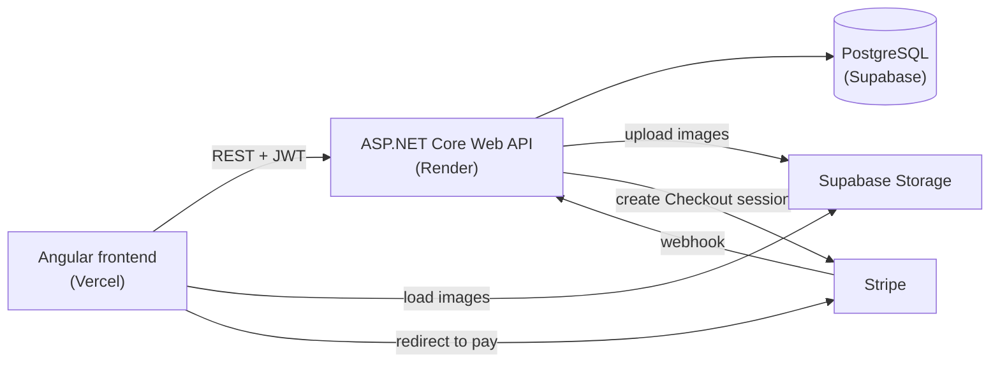
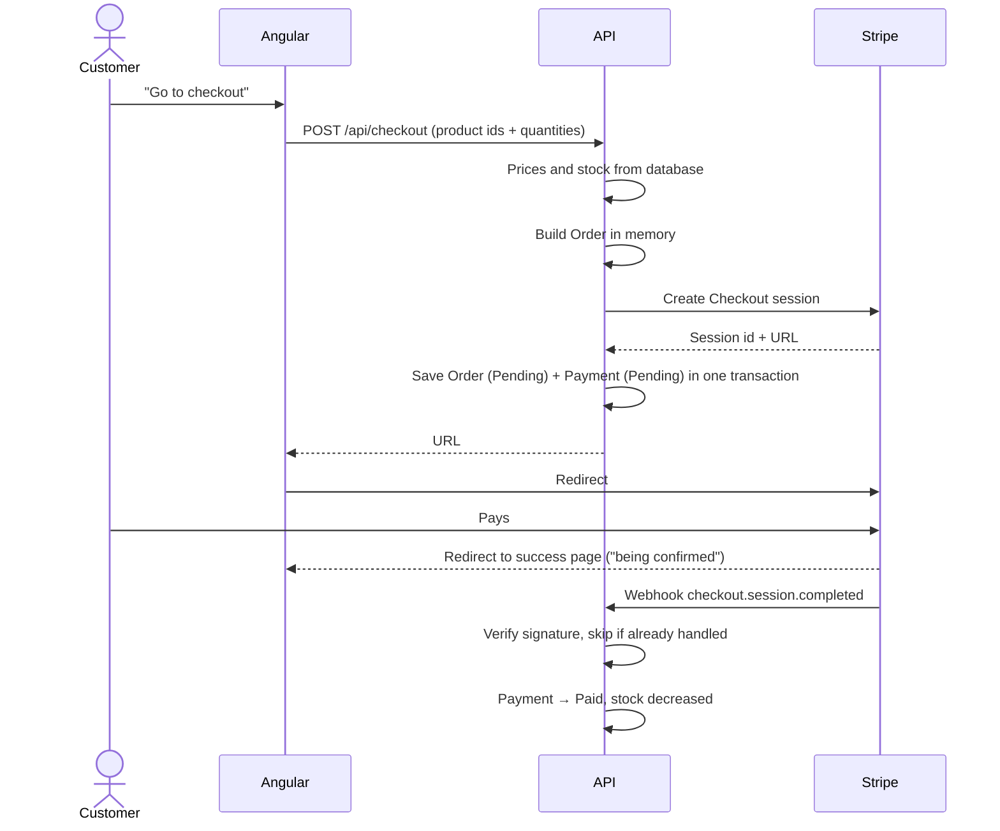
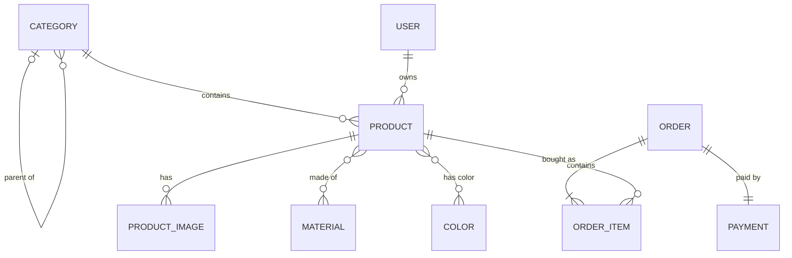

# Architecture – GREJ

How the system is built. What is built is in [scope.md](scope.md), the rules it must follow are in [constraints.md](constraints.md).

## Overview



| Part | Technology | Hosting |
|---|---|---|
| Frontend | Angular | Vercel |
| Backend | C# ASP.NET Core Web API, EF Core | Render (Docker) |
| Database | PostgreSQL | Supabase |
| Images | Supabase Storage | Supabase |
| Payments | Stripe Checkout (test mode) + webhook | Stripe |

The API runs on Render as a Docker container, since Render has no built-in .NET support. It connects to the database through Supabase's session pooler, because Render can only reach IPv4 addresses.

Local development and production currently use the same Supabase database and image bucket, so migrations applied locally also apply to production, and images uploaded locally are shown in production too. A separate production database is decided before real demo content is added.

## Modular monolith

The API is one application, deployed as one unit, split into modules with clear responsibilities:

| Module | Responsibility |
|---|---|
| **Catalog** | Products, categories, materials, colors, images, stock |
| **Orders** | Orders, order rows, order status |
| **Payments** | Payments, Stripe Checkout, webhook |
| **Identity** | Admin login, roles |

Modules use each other through application services, not through each other's tables or entities.

**Why:** one application is simple to deploy and debug for one developer, while the module boundaries keep the code organized and make it possible to grow or split a module later.

## Layers

Each module is split into the same layers. Dependencies only point inwards, towards the domain:

```
Api ──► Application ──► Domain
             ▲
Infrastructure
```

| Layer | Contains | Example |
|---|---|---|
| **Api** | Controllers, request/response models, authentication setup | `POST /api/checkout` |
| **Application** | Use cases and interfaces for infrastructure | "Create checkout", "Mark order as shipped", `IPaymentProvider` |
| **Domain** | Entities and business rules, no dependencies | `Order.MarkAsShipped()` refuses unless the payment is `Paid` |
| **Infrastructure** | EF Core and PostgreSQL, Stripe, Supabase Storage | `StripePaymentProvider`, `GrejDbContext` |

**Why:** the business rules do not depend on the database or Stripe, which makes them easy to test and makes it possible to replace infrastructure later.

## Solution structure

```
server/
  Grej.Api/              Controllers per module, Program.cs
  Grej.Application/      Catalog/, Orders/, Payments/, Identity/, Common/ (e.g. PagedResult)
  Grej.Domain/           Catalog/, Orders/, Payments/
  Grej.Infrastructure/   Persistence/ (DbContext, migrations, repositories), Identity/ (admin seed, login), Stripe/, Images/
  Grej.UnitTests/        Domain and application rules
  Grej.IntegrationTests/ API, checkout and webhook against a test database
client/
  src/app/
    core/                API services, auth interceptor, route guards
    shared/              Reusable components
    features/shop/       Product list, product page, cart, checkout, success page
    features/admin/      Login, products, categories, properties, orders
```

## Key decisions

| Decision | Why |
|---|---|
| **Stripe Checkout** (Stripe's hosted payment page) | No card data passes through my system; Stripe handles card errors and retries |
| **The webhook is the source of truth** for payments; signature verified; each event handled once | The browser can be closed or manipulated; Stripe may send the same event twice |
| **Payment is its own entity** with provider and reference, behind `IPaymentProvider` | More payment methods can be added later without changing the order flow |
| **Two statuses:** payment status (set by the provider) and order status (set by the admin) | Keeps "is it paid?" and "is it shipped?" separate, e.g. shipped but refunded |
| **Prices calculated in the API** from the database; title and price stored on each order row | Prices in the browser can be manipulated; old orders must not change |
| **Money as `decimal` + currency** (SEK in this version) | Floating point gives rounding errors; storing the currency keeps more currencies possible |
| **ASP.NET Core Identity + JWT**, role Admin | Frontend and API are on different domains, which makes tokens simpler than cookies |
| **Supabase for database and images** | One service I already know for both; images cannot be stored on Render, whose file system is cleared on every deploy |
| **Cart in localStorage** | Customers buy as guests, so there is no account to store the cart on |
| **`SellerId` on every product** (always the admin) | Cheap now, keeps a future marketplace possible |

## Checkout flow



The order is saved only after Stripe has created the session, together with its rows and payment in one transaction. If Stripe does not answer, nothing is saved, so there is never an order whose payment can never be paid. If the database fails after Stripe has answered, the customer never gets the URL and the unused session expires in Stripe, so the webhook must ignore sessions it does not know.

The other webhook events update the payment the same way:
- `checkout.session.expired` sets the payment to `Expired` and the order to `Cancelled`.
- `charge.refunded` sets the payment to `Refunded`.

## Data model



### Catalog

**Product**

| Column | Type | Note |
|---|---|---|
| Id | int | |
| Title | string | Required |
| Description | string | |
| Price | decimal | Greater than 0 |
| Currency | string | `SEK` |
| Stock | int | Unique art = 1; below 0 means the last item was sold twice |
| IsActive | bool | `false` = draft or hidden |
| CategoryId | → Category | Exactly one |
| SellerId | → User | Always the admin in this version |
| CreatedAt, UpdatedAt | datetime | |

**ProductImage**

| Column | Type | Note |
|---|---|---|
| Id | int | |
| ProductId | → Product | At most 10 per product |
| Url | string | Public URL in Supabase Storage |
| StoragePath | string | Path in Supabase Storage, used to delete the image |
| AltText | string | Required, at most 200 characters |
| SortOrder | int | First image is the main image |

**Category**

| Column | Type | Note |
|---|---|---|
| Id | int | |
| Name | string | At most 100 characters |
| ParentId | → Category, nullable | Only one level: a subcategory cannot have subcategories. Not built yet (Should, sprint 3) |

**Material**, **Color**: `Id`, `Name` (at most 100 characters). In the code both inherit from the abstract `ProductProperty`, which has no table of its own.

**ProductMaterials**, **ProductColors**: `ProductId`, `MaterialId` / `ColorId`, which together are the key. These are join tables for many-to-many, without a class of their own: EF Core fills them from `Product.Materials` and `Product.Colors`. Deleting a product, a material or a color deletes its rows here (cascade).

### Orders

**Order**

| Column | Type | Note |
|---|---|---|
| Id | int | |
| OrderNumber | string | Shown to the customer on the success page |
| Status | enum | `Pending`, `Shipped`, `Cancelled` |
| NeedsAttention | bool | Set on double sale of the last item (Should) |
| CustomerName, CustomerEmail | string | From Stripe Checkout |
| AddressLine1, AddressLine2, PostalCode, City, Country | string | From Stripe Checkout; Country is always `SE` for now |
| ShippingMethod, ShippingCost | string, decimal | Null until shipping cost is built |
| Total | decimal | Products + shipping |
| Currency | string | `SEK` |
| CreatedAt, UpdatedAt | datetime | |

**OrderItem**

| Column | Type | Note |
|---|---|---|
| Id | int | |
| OrderId | → Order | |
| ProductId | → Product | The product is never hard deleted once ordered |
| TitleAtPurchase | string | Copy at the time of purchase |
| UnitPrice | decimal | Copy at the time of purchase |
| Quantity | int | |

### Payments

**Payment**

| Column | Type | Note |
|---|---|---|
| Id | int | |
| OrderId | → Order | One payment per order in this version; a new checkout creates a new order |
| Provider | string | `Stripe` |
| ProviderReference | string | Stripe Checkout session id |
| Status | enum | `Pending`, `Paid`, `Expired`, `Refunded` |
| Amount | decimal | |
| Currency | string | `SEK` |
| CreatedAt, UpdatedAt | datetime | |

**ProcessedWebhookEvent**

| Column | Type | Note |
|---|---|---|
| EventId | string | Stripe's event id, primary key |
| ProcessedAt | datetime | Used to skip events that arrive twice |

### Identity

Users and roles use the standard ASP.NET Core Identity tables. The only role in this version is `Admin`.

The admin account is created with `dotnet run --project Grej.Api -- seed-admin` from `Admin:Email` and `Admin:Password` in User Secrets. `POST /api/auth/login` returns a JWT with the `Admin` role, valid for 8 hours, signed with `Jwt:SigningKey`. Five wrong passwords in a row lock the account for 5 minutes.

Every admin endpoint has `[Authorize(Roles = Roles.Admin)]`. The API checks the token's signature, issuer, audience and expiry with JwtBearer in `Program.cs`, using the same `Jwt` settings as the login. No valid token gives 401, and a token without the `Admin` role gives 403. `GET /api/auth/me` returns the logged-in admin's email.

In Angular, `authInterceptor` adds `Authorization: Bearer <token>` to requests to the API only, and logs the admin out if the API answers 401. `adminGuard` (`canActivateChild` on `/admin`) sends anyone without an unexpired token to `/admin/logga-in`. The guard only hides pages; the API is the real protection.

## CMS

The CMS has its own endpoints under `/api/admin/` (e.g. `/api/admin/products`), with `[Authorize(Roles = Roles.Admin)]` on the controller. The shop's endpoints stay open and only show active products. The same rules are checked in the Angular form and in the API, which answers 400 and saves nothing when a rule is broken.

- A product that is on an order cannot be deleted. The Catalog module asks the Orders module through `OrderService`, and the API answers 409; the admin hides the product instead. The foreign key from order rows to products also stops the delete.
- When the admin saves a product, the form sends the stock it was opened with. If a customer has bought the product since then, the API answers 409 and saves nothing, so a sale is never overwritten.

Known limitation: the stock must be 0 or more when the admin saves. A product with stock below 0 (the last item sold twice) therefore gets at least 0 if the admin edits it before the order is handled.

### Product images

The admin uploads one image per product with `PUT /api/admin/products/{id}/image` (a form with `file` and `altText`) and removes it with `DELETE /api/admin/products/{id}/image`. The file goes through the API, so the Supabase secret key (`Supabase:SecretKey`) stays on the server. Each file gets a new random name under `products/{id}/` in the public bucket `product-images`, and the browser loads it straight from its public URL.

- The API reads the file type from the file's first bytes, not its name. Only jpg, png and webp of at most 5 MB are accepted (400), and a larger request gets 413. The bucket has the same rules in Supabase.
- A new image is uploaded first, then the row is saved, and only then is the old file deleted. The database never points to a missing file; at worst an unused file is left in Storage (the same idea as in the checkout). Deleting a product deletes its file the same way, after the delete is saved.
- The images are always loaded with their product (`AutoInclude` in `ProductConfiguration`), so no query can forget them.
- The shop uses a plain ``, not `NgOptimizedImage`, since the image sizes are not stored and Supabase's free tier cannot resize images.

Known limitation: the alt text can only be changed by uploading the image again.

### Categories

The admin creates, renames and deletes categories with `/api/admin/categories`. The list is sorted by name and, like every list, paginated, with up to 100 categories per page, so the menu in the product form gets them all from the first page. A product must have a category that exists: a missing or unknown `categoryId` gives 400.

- A category that has products cannot be deleted. `AdminCategoryService` asks the product repository directly, since both are in the Catalog module, and the API answers 409; the admin moves the products first. The foreign key from products to categories (`Restrict`) also stops the delete.
- A new product gets the logged-in admin as its owner (`SellerId`, from the token's `sub` claim). Editing a product never changes its owner.
- The migration `AddCategories` gave every existing product a new category "Övrigt", the admin as owner and the time of the migration as `CreatedAt`/`UpdatedAt`, since the new columns cannot be empty. The demo product seed was removed, since a product needs an owner and the admin is created after the migrations.

Known limitations: two categories can have the same name, and the product form's menu shows at most 100 categories.

### Materials and colors

The admin creates, renames and deletes materials with `/api/admin/materials` and colors with `/api/admin/colors`, and ticks several of each (or none) in the product form. The shop's product page shows their names.

- Materials and colors work the same way, so the code is written once with generics: `PropertyRepository<T>`, `AdminPropertyService<T>` and the abstract `AdminPropertiesController<T>`, with one short controller per route. In Angular, one list page, one form page and one checkbox component take a `kind` (`'materials'` or `'colors'`) from the route's `data` and look up the Swedish words in `property-texts.ts`.
- The product form sends `materialIds` and `colorIds`, which replace the product's old ones. An id that does not exist gives 400 and nothing is saved, the same as an unknown category. The CMS gets the ids, the shop gets the names sorted.
- A material or a color can be deleted even if products have it (ambiguity.md). `GET /api/admin/materials/{id}` (and the same for colors) includes `productCount`, so the form can say how many products lose it before asking the admin to confirm.
- The materials and colors are always loaded with their product (`AutoInclude`), as one SQL query (`QuerySplittingBehavior.SingleQuery`), since a product has few of each.

Known limitations: two materials or colors can have the same name, the product form shows at most 100 of each, and the number in the warning is from when the page was opened.
