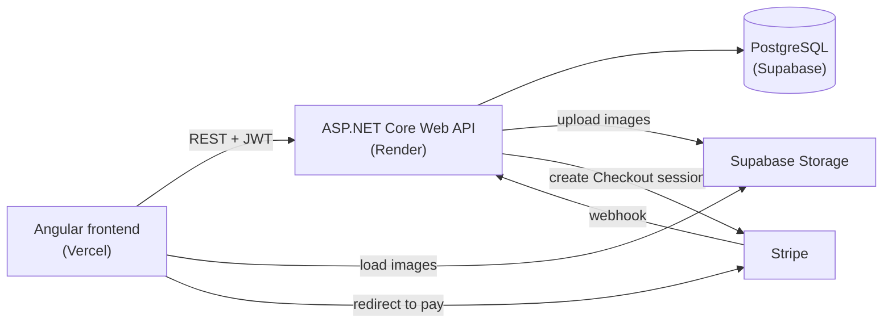
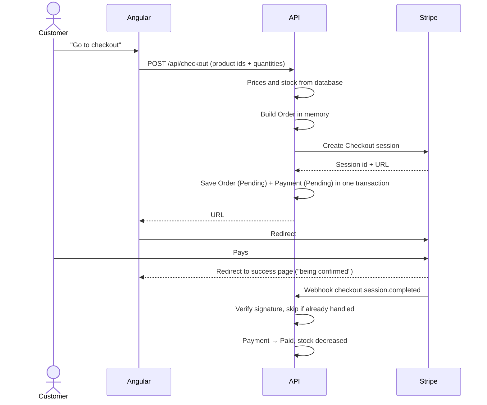
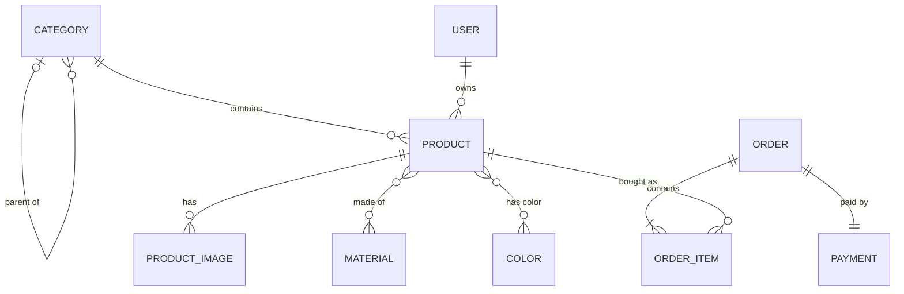

# Architecture – GREJ

How the system is built. What is built is in [scope.md](scope.md), the rules it must follow are in [constraints.md](constraints.md).

## Overview



| Part | Technology | Hosting |
|---|---|---|
| Frontend | Angular | Vercel |
| Backend | C# ASP.NET Core Web API, EF Core | Render (Docker) |
| Database | PostgreSQL | Supabase |
| Images | Supabase Storage | Supabase |
| Payments | Stripe Checkout (test mode) + webhook | Stripe |

The API runs on Render as a Docker container, since Render has no built-in .NET support. It connects to the database through Supabase's session pooler, because Render can only reach IPv4 addresses.

Local development and production use the same Supabase database and image bucket, so migrations applied locally also apply to production, and images uploaded locally are shown in production too. There is no separate production database, since everything in the shop is demo content, so `reset-demo` resets the deployed shop too (see Demo data).

## Modular monolith

The API is one application, deployed as one unit, split into modules with clear responsibilities:

| Module | Responsibility |
|---|---|
| **Catalog** | Products, categories, materials, colors, images, stock |
| **Orders** | Orders, order rows, order status |
| **Payments** | Payments, Stripe Checkout, webhook |
| **Identity** | Admin login, roles |

Modules use each other through application services, not through each other's tables or entities.

**Why:** one application is simple to deploy and debug for one developer, while the module boundaries keep the code organized and make it possible to grow or split a module later.

## Layers

Each module is split into the same layers. Dependencies only point inwards, towards the domain:

```
Api ──► Application ──► Domain
             ▲
Infrastructure
```

| Layer | Contains | Example |
|---|---|---|
| **Api** | Controllers, request/response models, authentication setup | `POST /api/checkout` |
| **Application** | Use cases and interfaces for infrastructure | "Create checkout", "Mark order as shipped", `IPaymentProvider` |
| **Domain** | Entities and business rules, no dependencies | `Order.MarkAsShipped()` refuses unless the payment is `Paid` |
| **Infrastructure** | EF Core and PostgreSQL, Stripe, Supabase Storage | `StripePaymentProvider`, `GrejDbContext` |

**Why:** the business rules do not depend on the database or Stripe, which makes them easy to test and makes it possible to replace infrastructure later.

## Solution structure

```
server/
  Grej.Api/              Controllers per module, Program.cs
  Grej.Application/      Catalog/, Orders/, Payments/, Identity/, Common/ (e.g. PagedResult)
  Grej.Domain/           Catalog/, Orders/, Payments/
  Grej.Infrastructure/   Persistence/ (DbContext, migrations, repositories), Identity/ (admin seed, login), Stripe/, Images/, DemoData/ (demo content, reset-demo)
  Grej.UnitTests/        Domain and application rules
  Grej.IntegrationTests/ API, checkout and webhook against a test database
client/
  src/styles/            Shared style variables and base styles
  src/app/
    core/                API services, auth interceptor, route guards
    shared/              Reusable components (button, icon, badge, pagination) and helpers
    features/shop/       Shop layout, start page, product list, product page, cart, checkout, success page
    features/admin/      Login, products, categories, properties, orders
```

## Key decisions

| Decision | Why |
|---|---|
| **Stripe Checkout** (Stripe's hosted payment page) | No card data passes through my system; Stripe handles card errors and retries |
| **The webhook is the source of truth** for payments; signature verified; each event handled once | The browser can be closed or manipulated; Stripe may send the same event twice |
| **Payment is its own entity** with provider and reference, behind `IPaymentProvider` | More payment methods can be added later without changing the order flow |
| **Two statuses:** payment status (set by the provider) and order status (set by the admin) | Keeps "is it paid?" and "is it shipped?" separate, e.g. shipped but refunded |
| **Prices calculated in the API** from the database; title and price stored on each order row | Prices in the browser can be manipulated; old orders must not change |
| **Money as `decimal` + currency** (SEK in this version) | Floating point gives rounding errors; storing the currency keeps more currencies possible |
| **ASP.NET Core Identity + JWT**, role Admin | Frontend and API are on different domains, which makes tokens simpler than cookies |
| **Supabase for database and images** | One service I already know for both; images cannot be stored on Render, whose file system is cleared on every deploy |
| **Cart in localStorage** | Customers buy as guests, so there is no account to store the cart on |
| **`SellerId` on every product** (always the admin) | Cheap now, keeps a future marketplace possible |
| **One database** for development and the deployed shop, filled by `reset-demo` | Everything in the shop is demo content, so a second database would only add setup; the cost is that a reset or a migration reaches the deployed shop at once |

## Checkout flow



The order is saved only after Stripe has created the session, together with its rows and payment in one transaction. If Stripe does not answer, nothing is saved, so there is never an order whose payment can never be paid. If the database fails after Stripe has answered, the customer never gets the URL and the unused session expires in Stripe, so the webhook must ignore sessions it does not know.

The other webhook events update the payment the same way:
- `checkout.session.expired` sets the payment to `Expired` and the order to `Cancelled`.
- `charge.refunded` sets the payment to `Refunded` when the whole amount has been returned; a partial refund is ignored (scope.md). It never changes the order or the stock (constraints.md).

A refund event carries the charge, which knows its PaymentIntent (`pi_…`) but not the Checkout session. So `checkout.session.completed` stores the session's PaymentIntent id on the payment (`ProviderPaymentId`), and `PaymentRepository.GetByReferenceAsync` finds a payment by either id.

Known limitations: payments that were paid before the migration `AddProviderPaymentId` have no PaymentIntent id, so their refunds are ignored (`reset-demo` removes them). A refund that arrives before its payment's `checkout.session.completed` has been handled is ignored too; in practice the admin refunds much later.

## Data model



### Catalog

**Product**

| Column | Type | Note |
|---|---|---|
| Id | int | |
| Title | string | Required |
| Description | string | |
| Price | decimal | Greater than 0 |
| Currency | string | `SEK` |
| Stock | int | Unique art = 1; below 0 means the last item was sold twice |
| IsActive | bool | `false` = draft or hidden |
| CategoryId | → Category | Exactly one |
| SellerId | → User | Always the admin in this version |
| CreatedAt, UpdatedAt | datetime | |

**ProductImage**

| Column | Type | Note |
|---|---|---|
| Id | int | |
| ProductId | → Product | At most 10 per product |
| Url | string | Public URL in Supabase Storage |
| StoragePath | string | Path in Supabase Storage, used to delete the image |
| AltText | string | Required, at most 200 characters |
| SortOrder | int | First image is the main image |

**Category**

| Column | Type | Note |
|---|---|---|
| Id | int | |
| Name | string | At most 100 characters |
| ParentId | → Category, nullable | Only one level: a subcategory cannot have subcategories. Not built yet (Should, sprint 3) |

**Material**, **Color**: `Id`, `Name` (at most 100 characters). In the code both inherit from the abstract `ProductProperty`, which has no table of its own.

**ProductMaterials**, **ProductColors**: `ProductId`, `MaterialId` / `ColorId`, which together are the key. These are join tables for many-to-many, without a class of their own: EF Core fills them from `Product.Materials` and `Product.Colors`. Deleting a product, a material or a color deletes its rows here (cascade).

### Orders

**Order**

| Column | Type | Note |
|---|---|---|
| Id | int | |
| OrderNumber | string | Shown to the customer on the success page |
| Status | enum | `Pending`, `Shipped`, `Cancelled` |
| NeedsAttention | bool | Set on double sale of the last item (Should) |
| CustomerName, CustomerEmail | string | From Stripe Checkout |
| AddressLine1, AddressLine2, PostalCode, City, Country | string | From Stripe Checkout; Country is always `SE` for now |
| ShippingMethod, ShippingCost | string, decimal | Null until shipping cost is built |
| Total | decimal | Products + shipping |
| Currency | string | `SEK` |
| CreatedAt, UpdatedAt | datetime | |

**OrderItem**

| Column | Type | Note |
|---|---|---|
| Id | int | |
| OrderId | → Order | |
| ProductId | → Product | The product is never hard deleted once ordered |
| TitleAtPurchase | string | Copy at the time of purchase |
| UnitPrice | decimal | Copy at the time of purchase |
| Quantity | int | |

### Payments

**Payment**

| Column | Type | Note |
|---|---|---|
| Id | int | |
| OrderId | → Order | One payment per order in this version; a new checkout creates a new order |
| Provider | string | `Stripe` |
| ProviderReference | string | Stripe Checkout session id |
| ProviderPaymentId | string, nullable | Stripe PaymentIntent id, stored when paid; refund events find the payment by it |
| Status | enum | `Pending`, `Paid`, `Expired`, `Refunded` |
| Amount | decimal | |
| Currency | string | `SEK` |
| CreatedAt, UpdatedAt | datetime | |

**ProcessedWebhookEvent**

| Column | Type | Note |
|---|---|---|
| EventId | string | Stripe's event id, primary key |
| ProcessedAt | datetime | Used to skip events that arrive twice |

### Identity

Users and roles use the standard ASP.NET Core Identity tables. The only role in this version is `Admin`.

The admin account is created with `dotnet run --project Grej.Api -- seed-admin` from `Admin:Email` and `Admin:Password` in User Secrets. `POST /api/auth/login` returns a JWT with the `Admin` role, valid for 8 hours, signed with `Jwt:SigningKey`. Five wrong passwords in a row lock the account for 5 minutes.

Every admin endpoint has `[Authorize(Roles = Roles.Admin)]`. The API checks the token's signature, issuer, audience and expiry with JwtBearer in `Program.cs`, using the same `Jwt` settings as the login. No valid token gives 401, and a token without the `Admin` role gives 403. `GET /api/auth/me` returns the logged-in admin's email.

In Angular, `authInterceptor` adds `Authorization: Bearer <token>` to requests to the API only, and logs the admin out if the API answers 401. `adminGuard` (`canActivateChild` on `/admin`) sends anyone without an unexpired token to `/admin/logga-in`. The guard only hides pages; the API is the real protection.

### Demo data

`dotnet run --project Grej.Api -- reset-demo` empties the shop and fills it with the content in `Grej.Infrastructure/DemoData/`: `demo-catalog.json` (categories, materials, colors, products and orders) and one placeholder image per category. It asks the developer to type `RESET` first, since the database is shared with the deployed shop.

- The shop's tables are emptied with `TRUNCATE … RESTART IDENTITY` in the same transaction as the seed, so the ids start at 1 and a failure leaves the old content. Identity's tables are not in the list, so the admin account is kept, and it owns every product.
- Every product gets its own copy of its category's image under `products/{id}/`, like an upload in the CMS. The old files are deleted after the commit.
- The products are saved in turns across the categories, so the shop's first page (newest first) shows every category.
- The demo orders are built with the same `Order` methods as real ones: paid, and then shipped or cancelled as the file says. Their `CreatedAt` is set to a number of days ago, so the list shows different dates. The stock in the file is what is left after the orders, so the seed does not change it.
- `DemoCatalogTests` checks the file against the CMS's rules, so a typo is found by `dotnet test`. The files are copied to the build output but not to the published API.

Known limitation: the demo orders' payments have the provider `Demo` and no Stripe session, so they cannot be refunded in Stripe.

Before the presentation, `reset-demo` is run once after the feature freeze and then left alone.

## CMS

The CMS has its own endpoints under `/api/admin/` (e.g. `/api/admin/products`), with `[Authorize(Roles = Roles.Admin)]` on the controller. The shop's endpoints stay open and only show active products. The same rules are checked in the Angular form and in the API, which answers 400 and saves nothing when a rule is broken.

- A product that is on an order cannot be deleted. The Catalog module asks the Orders module through `OrderService`, and the API answers 409; the admin hides the product instead. The foreign key from order rows to products also stops the delete.
- When the admin saves a product, the form sends the stock it was opened with. If a customer has bought the product since then, the API answers 409 and saves nothing, so a sale is never overwritten.

Known limitation: the stock must be 0 or more when the admin saves. A product with stock below 0 (the last item sold twice) therefore gets at least 0 if the admin edits it before the order is handled.

### Product images

The admin uploads one image per product with `PUT /api/admin/products/{id}/image` (a form with `file` and `altText`) and removes it with `DELETE /api/admin/products/{id}/image`. The file goes through the API, so the Supabase secret key (`Supabase:SecretKey`) stays on the server. Each file gets a new random name under `products/{id}/` in the public bucket `product-images`, and the browser loads it straight from its public URL.

- The API reads the file type from the file's first bytes, not its name. Only jpg, png and webp of at most 5 MB are accepted (400), and a larger request gets 413. The bucket has the same rules in Supabase.
- A new image is uploaded first, then the row is saved, and only then is the old file deleted. The database never points to a missing file; at worst an unused file is left in Storage (the same idea as in the checkout). Deleting a product deletes its file the same way, after the delete is saved.
- The images are always loaded with their product (`AutoInclude` in `ProductConfiguration`), so no query can forget them.
- The shop uses a plain ``, not `NgOptimizedImage`, since the image sizes are not stored and Supabase's free tier cannot resize images.

Known limitation: the alt text can only be changed by uploading the image again.

### Categories

The admin creates, renames and deletes categories with `/api/admin/categories`. The list is sorted by name and, like every list, paginated, with up to 100 categories per page, so the menu in the product form gets them all from the first page. A product must have a category that exists: a missing or unknown `categoryId` gives 400.

- A category that has products cannot be deleted. `AdminCategoryService` asks the product repository directly, since both are in the Catalog module, and the API answers 409; the admin moves the products first. The foreign key from products to categories (`Restrict`) also stops the delete.
- A new product gets the logged-in admin as its owner (`SellerId`, from the token's `sub` claim). Editing a product never changes its owner.
- The migration `AddCategories` gave every existing product a new category "Övrigt", the admin as owner and the time of the migration as `CreatedAt`/`UpdatedAt`, since the new columns cannot be empty. The old demo product seed was later replaced by `reset-demo` (see Demo data).

Known limitations: two categories can have the same name, and the product form's menu shows at most 100 categories.

### Materials and colors

The admin creates, renames and deletes materials with `/api/admin/materials` and colors with `/api/admin/colors`, and ticks several of each (or none) in the product form. The shop's product page shows their names.

- Materials and colors work the same way, so the code is written once with generics: `PropertyRepository<T>`, `AdminPropertyService<T>` and the abstract `AdminPropertiesController<T>`, with one short controller per route. In Angular, one list page, one form page and one checkbox component take a `kind` (`'materials'` or `'colors'`) from the route's `data` and look up the Swedish words in `property-texts.ts`.
- The product form sends `materialIds` and `colorIds`, which replace the product's old ones. An id that does not exist gives 400 and nothing is saved, the same as an unknown category. The CMS gets the ids, the shop gets the names sorted.
- A material or a color can be deleted even if products have it (ambiguity.md). `GET /api/admin/materials/{id}` (and the same for colors) includes `productCount`, so the form can say how many products lose it before asking the admin to confirm.
- The materials and colors are always loaded with their product (`AutoInclude`), as one SQL query (`QuerySplittingBehavior.SingleQuery`), since a product has few of each.

Known limitations: two materials or colors can have the same name, the product form shows at most 100 of each, and the number in the warning is from when the page was opened.

### Orders

The admin reads orders with `/api/admin/orders` and `/api/admin/orders/{id}`, at `/admin/ordrar` in the CMS. The admin changes the order status with `POST /api/admin/orders/{id}/ship` and `POST /api/admin/orders/{id}/cancel`. Both answer 204, 404 if the order does not exist, and 409 if the order's status or payment does not allow the change.

- By default the list ("Att göra") shows what the admin has to do: paid orders that are not shipped, oldest first, so the order that has waited longest is at the top. These are the orders to ship and the cancelled ones that need a refund, and also the refunded ones that are not cancelled yet. `?all=true` (`?visa=alla` in the CMS) shows every order, also unpaid and cancelled ones, newest first (ambiguity.md).
- The order page shows the customer, the address and each row with its title and price from the time of purchase. The customer details are empty until the webhook has stored them from Stripe.
- The rules are in `Order`. `CanBeShipped` is true for a pending, paid order, and `CanBeCancelledByAdmin` for a pending order that is paid or refunded. `NeedsRefund` is true for a cancelled, paid order, and `NeedsCancelling` for a pending, refunded one (the admin refunded in Stripe before cancelling). `MarkAsShipped` and `CancelByAdmin` refuse when a rule is broken. `AdminOrderService` checks first, so a refused change becomes 409 and not an exception.
- The API sends these answers to the CMS (`canBeShipped`, `canBeCancelled`, `needsRefund`, `needsCancelling`). The CMS shows only the buttons the order allows and has no rules of its own.
- Cancelling puts the order's products back in stock through `ProductService`, and the order and the stock are saved in one transaction. The admin refunds the customer in the Stripe dashboard, and the webhook then marks the payment as `Refunded` (ambiguity.md).
- The statuses are sent as text (`"Paid"`), and the CMS shows them in Swedish (`order-texts.ts`). Row totals are calculated in the API, like every price.
- The pagination keeps the list's other query parameters, so `?visa=alla` is kept on the next page.

Known limitation: if the same order is shipped and cancelled at the same time (e.g. in two tabs), both changes can be saved, and the last one decides the status. Two cancels at the same time cannot both be saved, because of the concurrency token on `Product.Stock`, so the stock is never increased twice.

## Styles

The look is built on the design tokens in the Figma file (page Foundations). `client/src/styles/_tokens.scss` has every Figma variable as a CSS custom property with the same name as Figma's "Code syntax": the palette (`--color-sand`, `--color-charcoal` …), the color tokens that point at it with `var()` (`--color-bg-page`, `--color-text-primary` …), spacing named after its size in px (`--space-2` … `--space-160`), border widths, Figma's popover shadow, and the responsive font sizes and layout values (`--layout-margin`, `--layout-gutter`). The responsive ones are mobile first: the phone's values in `:root`, and new values in media queries for a tablet (from 768 px) and a computer (from 1024 px), Figma's `layout/breakpoint-min`. `_typography.scss` has one class per Figma text style (e.g. `.text-display-l`, `.text-label-s`), built by a Sass mixin; the templates put the class on the element, and `<body class="text-body-m">` gives the body text. Components only use `var(--…)` and the classes, so a change in Figma is a change in one place, and dark mode (Could) only needs new values. Every text color has at least 4.5:1 contrast against its background, and field borders and the focus ring at least 3:1 (WCAG AA). Figma has no hover or focus states, so they use Figma's own colors: dark buttons get `--color-graphite`, light ones `--color-oat`, links are underlined, and the focus ring is 2 px in `--color-border-default` (`--color-border-inverse` on the dark bands). `_base.scss` styles plain HTML elements with the variables: links, form fields, tables and the keyboard focus ring.

The component library is small and our own, in `shared/`, instead of e.g. Angular Material, so the Signal Forms forms keep their native fields. Each component matches a component in the Figma file, so a change in the design changes one file:

- `Button` is an attribute on a real `<button>` or `<a>` (`<button appButton variant="danger">`), so the element keeps the browser's keyboard handling, form submit, `disabled` and `routerLink`. It has three variants (primary, secondary with a 2 px frame, danger; the frame is taken from the padding, so all are equally tall, unlike Figma where the secondary is 4 px taller) and two sizes (normal for forms and the CMS, `size="large"` for the shop's big buttons).
- `Icon` shows one of the design's icons from `public/icons/` as a CSS mask, so it takes the text color around it. `IconButton` is a square button with only an icon (e.g. close), and always needs an `aria-label`.
- `Badge` is a small label on a product image, e.g. "Slutsåld" and "Få kvar".
- `Pagination` shows the links to the page before and after and the page numbers (`?sida=`), e.g. 1 2 3 … 8, with a shorter list on a phone. It shows nothing when the list fits on one page.
- `Breadcrumb` shows e.g. "Hem / Shop / Vas" above a page's title; the current page comes last and is not a link.
- `QuantityStepper` is the − 1 + control in the cart and on the product page (`[(quantity)]` with `min` and `max`). Its buttons are squares of `--stepper-button-size`, which the product page sets so the stepper is as tall as the large button; that makes it wider than in Figma.
- `StockStatus` is a colored dot and the stock as text: "Slutsåld" (grey), "Få kvar – 2 st" (red, 1–2 left), "I lager – 4 st" (yellow, 3–5) and "I lager – 12 st" (green, 6 or more). The yellow is `--color-feedback-warning` (`--color-ochre`), which was added to Figma for it.

The shop's own design is made in Figma (GREJ – Webshop design) in three sizes: a phone (390 px), a tablet (768 px) and a computer (1440 px). It has neutral colors, Anton for headings, Inter for text and Space Mono for small print; the fonts are loaded from Google Fonts in `index.html`. The variables have the design's values, so the CMS gets the same colors and fonts. The Figma file also shows things that are not built yet (filters, sorting, makers, free shipping); only what has working code is shown in the shop.

- `ShopLayout` (`features/shop/shop-layout/`) has the shop's header (logo, menu, cart) and footer. The shop's routes are its children in `app.routes.ts`, so the admin pages have no shop header. Its bands go from edge to edge, and the content inside them uses `.page-width`: centered, at most as wide as Figma's computer frame (`--layout-viewport-width`, 1440 px), with `--layout-margin` on the sides (20 px on a phone, 32 px on a tablet, 48 px on a computer). On a phone the menu links are in `MobileMenu`, a `<dialog>` like the cart.
- `ProductCard` is used by both the start page and the product list: image, title, price, a "Slutsåld" or "Få kvar" (1–2 left) badge, and an add button. The add button is a bar over the image on hover or keyboard focus on a computer, and a "+" square on a tablet and a phone, where there is no hover.
- The start page (`/`, `LandingPage`) has a big title, a moving band of words, the four newest products (the first four from `GET /api/products`, which sorts the newest first; a row to swipe through on a phone) and links to the categories. The band pauses on hover and stands still for people who have turned on "reduce motion". The categories are hard-coded until the category filter is built.
- The product list (`/produkter`) has a breadcrumb, the title with the number of products, a toolbar with "Visar 1–12 av 40 grejer", and two, three or four products per row. The filters will take a column on the left when they are built.
- The product page (`/produkter/:id`) has a breadcrumb, `ProductGallery` (a big image and thumbnails to choose from, built for several images although the API has one), the title, price and `StockStatus`, the first 150 characters of the description with "Mer information" (opens "Beskrivning", a `<details>`, and scrolls to it), the material and color rows, and the buy row (`QuantityStepper` and "Lägg i varukorg"). On a phone the buy row is sticky at the bottom of the screen until the page is scrolled down to its place, where it stays; `scroll-padding-bottom` keeps the keyboard focus above it. It is not sticky on screens lower than 480 px, e.g. when zoomed in, where it would cover too much. This differs from Figma's separate buy bar with price and stock on purpose, so the page never shows two buy buttons. The maker, the "NY" badge, the size and care rows, the delivery notes and "Du kanske också gillar" are in Figma but not built, since the API has no data for them.
- The cart (`CartDrawer`) shows each row with a picture (the cart saves the product's image when it is added), a `QuantityStepper`, the total, and an empty state. When something is added, `AddedToCart` shows a small popup under the cart button that closes itself after 5 seconds (paused on hover or focus), with the cross or with Escape; it never takes the focus and is read by screen readers through `aria-live`.
- The success page (`/kassa/tack?order=…`) has a check mark, the title, the order number from the URL and "Din beställning håller på att bekräftas", "Vad händer nu?" as a numbered list (the numbers are centered against the text, not at the top as in Figma), "Fortsätt handla" and a note that the shop is a demo where no money is taken and nothing is sent. Figma's order summary, delivery and payment boxes and "Skriv ut kvitto" are not built, since the page only has the order number (there is no public endpoint for an order), and the email texts are left out, since no email is sent. Without the summary the column keeps Figma's width of 800 px on a computer.
- Each size has Figma's values for its frame: a phone up to 767 px, a tablet from 768 px and a computer from 1024 px. The font sizes change through the variables; spacing and layout changes (columns, the menu, the add button) use media queries at 48rem (768 px) and 64rem (1024 px) in the components, written phone first. The footer's big "GREJ." is at most 42 % of the screen width, so the computer's 500 px letters fit between 1024 and 1190 px.
- The Display text styles have line height 116 % (except Wordmark), so the dots on Å, Ä and Ö do not reach the row or line above. The sold-out layer over a product image differs from Figma on purpose: 70 % instead of 100 %, so the image can still be seen.

The CMS has no Figma design; it uses the variables, the text styles (its headings are Display/XS and Display/2XS) and the shared components.
