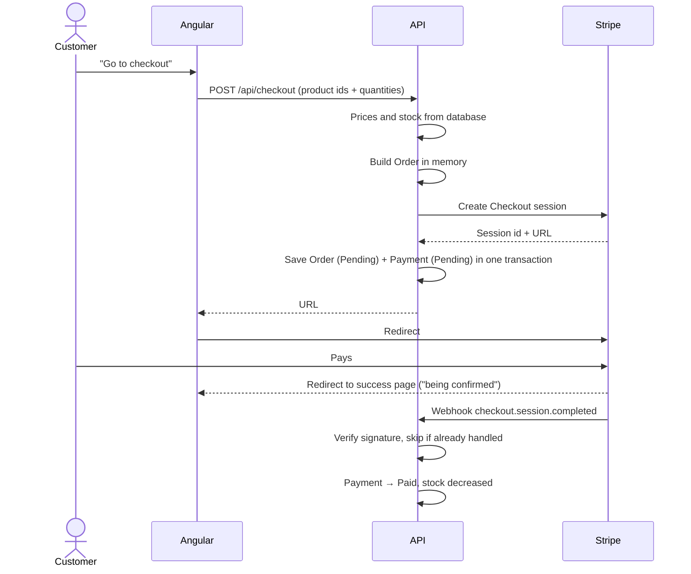
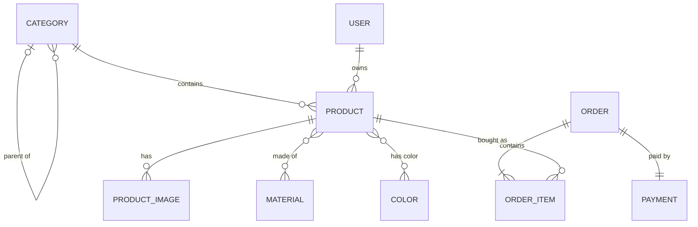

# Architecture – GREJ

How the system is built. What is built is in [scope.md](scope.md), the rules it must follow are in [constraints.md](constraints.md).

## Overview

```mermaid
flowchart LR
    Browser["Angular frontend<br/>(Vercel)"] -->|REST + JWT| API["ASP.NET Core Web API<br/>(Render)"]
    API --> DB[("PostgreSQL<br/>(Supabase)")]
    API -->|upload images| Storage["Supabase Storage"]
    Browser -->|load images| Storage
    API -->|create Checkout session| Stripe["Stripe"]
    Browser -->|redirect to pay| Stripe
    Stripe -->|webhook| API
```



| Part | Technology | Hosting |
|---|---|---|
| Frontend | Angular | Vercel |
| Backend | C# ASP.NET Core Web API, EF Core | Render (Docker) |
| Database | PostgreSQL | Supabase |
| Images | Supabase Storage | Supabase |
| Payments | Stripe Checkout (test mode) + webhook | Stripe |

The API runs on Render as a Docker container, since Render has no built-in .NET support. It connects to the database through Supabase's session pooler, because Render can only reach IPv4 addresses.

Local development and production currently use the same Supabase database, so migrations applied locally also apply to production. A separate production database is decided before real demo content is added.

## Modular monolith

The API is one application, deployed as one unit, split into modules with clear responsibilities:

| Module | Responsibility |
|---|---|
| **Catalog** | Products, categories, materials, colors, images, stock |
| **Orders** | Orders, order rows, order status |
| **Payments** | Payments, Stripe Checkout, webhook |
| **Identity** | Admin login, roles |

Modules use each other through application services, not through each other's tables or entities.

**Why:** one application is simple to deploy and debug for one developer, while the module boundaries keep the code organized and make it possible to grow or split a module later.

## Layers

Each module is split into the same layers. Dependencies only point inwards, towards the domain:

```
Api ──► Application ──► Domain
             ▲
Infrastructure
```

| Layer | Contains | Example |
|---|---|---|
| **Api** | Controllers, request/response models, authentication setup | `POST /api/checkout` |
| **Application** | Use cases and interfaces for infrastructure | "Create checkout", "Mark order as shipped", `IPaymentProvider` |
| **Domain** | Entities and business rules, no dependencies | `Order.MarkAsShipped()` refuses unless the payment is `Paid` |
| **Infrastructure** | EF Core and PostgreSQL, Stripe, Supabase Storage | `StripePaymentProvider`, `GrejDbContext` |

**Why:** the business rules do not depend on the database or Stripe, which makes them easy to test and makes it possible to replace infrastructure later.

## Solution structure

```
server/
  Grej.Api/              Controllers per module, Program.cs
  Grej.Application/      Catalog/, Orders/, Payments/, Identity/
  Grej.Domain/           Catalog/, Orders/, Payments/
  Grej.Infrastructure/   Persistence/ (DbContext, migrations, seed), Stripe/, Images/
  Grej.UnitTests/        Domain and application rules
  Grej.IntegrationTests/ API, checkout and webhook against a test database
client/
  src/app/
    core/                API services, auth interceptor, route guards
    shared/              Reusable components
    features/shop/       Product list, product page, cart, checkout, success page
    features/admin/      Login, products, categories, properties, orders
```

## Key decisions

| Decision | Why |
|---|---|
| **Stripe Checkout** (Stripe's hosted payment page) | No card data passes through my system; Stripe handles card errors and retries |
| **The webhook is the source of truth** for payments; signature verified; each event handled once | The browser can be closed or manipulated; Stripe may send the same event twice |
| **Payment is its own entity** with provider and reference, behind `IPaymentProvider` | More payment methods can be added later without changing the order flow |
| **Two statuses:** payment status (set by the provider) and order status (set by the admin) | Keeps "is it paid?" and "is it shipped?" separate, e.g. shipped but refunded |
| **Prices calculated in the API** from the database; title and price stored on each order row | Prices in the browser can be manipulated; old orders must not change |
| **Money as `decimal` + currency** (SEK in this version) | Floating point gives rounding errors; storing the currency keeps more currencies possible |
| **ASP.NET Core Identity + JWT**, role Admin | Frontend and API are on different domains, which makes tokens simpler than cookies |
| **Supabase for database and images** | One service I already know for both; images cannot be stored on Render, whose file system is cleared on every deploy |
| **Cart in localStorage** | Customers buy as guests, so there is no account to store the cart on |
| **`SellerId` on every product** (always the admin) | Cheap now, keeps a future marketplace possible |

## Checkout flow



The order is saved only after Stripe has created the session, together with its rows and payment in one transaction. If Stripe does not answer, nothing is saved, so there is never an order whose payment can never be paid. If the database fails after Stripe has answered, the customer never gets the URL and the unused session expires in Stripe, so the webhook must ignore sessions it does not know.

The other webhook events update the payment the same way:
- `checkout.session.expired` sets the payment to `Expired` and the order to `Cancelled`.
- `charge.refunded` sets the payment to `Refunded`.

## Data model



### Catalog

**Product**

| Column | Type | Note |
|---|---|---|
| Id | int | |
| Title | string | Required |
| Description | string | |
| Price | decimal | Greater than 0 |
| Currency | string | `SEK` |
| Stock | int | Unique art = 1; below 0 means the last item was sold twice |
| IsActive | bool | `false` = draft or hidden |
| CategoryId | → Category | Exactly one |
| SellerId | → User | Always the admin in this version |
| CreatedAt, UpdatedAt | datetime | |

**ProductImage**

| Column | Type | Note |
|---|---|---|
| Id | int | |
| ProductId | → Product | At most 10 per product |
| Url | string | Public URL in Supabase Storage |
| StoragePath | string | Path in Supabase Storage, used to delete the image |
| AltText | string | |
| SortOrder | int | First image is the main image |

**Category**

| Column | Type | Note |
|---|---|---|
| Id | int | |
| Name | string | |
| ParentId | → Category, nullable | Only one level: a subcategory cannot have subcategories |

**Material**, **Color**: `Id`, `Name`.

**ProductMaterial**, **ProductColor**: `ProductId`, `MaterialId` / `ColorId`. These are join tables for many-to-many.

### Orders

**Order**

| Column | Type | Note |
|---|---|---|
| Id | int | |
| OrderNumber | string | Shown to the customer on the success page |
| Status | enum | `Pending`, `Shipped`, `Cancelled` |
| NeedsAttention | bool | Set on double sale of the last item (Should) |
| CustomerName, CustomerEmail | string | From Stripe Checkout |
| AddressLine1, AddressLine2, PostalCode, City, Country | string | From Stripe Checkout; Country is always `SE` for now |
| ShippingMethod, ShippingCost | string, decimal | Null until shipping cost is built |
| Total | decimal | Products + shipping |
| Currency | string | `SEK` |
| CreatedAt, UpdatedAt | datetime | |

**OrderItem**

| Column | Type | Note |
|---|---|---|
| Id | int | |
| OrderId | → Order | |
| ProductId | → Product | The product is never hard deleted once ordered |
| TitleAtPurchase | string | Copy at the time of purchase |
| UnitPrice | decimal | Copy at the time of purchase |
| Quantity | int | |

### Payments

**Payment**

| Column | Type | Note |
|---|---|---|
| Id | int | |
| OrderId | → Order | One payment per order in this version; a new checkout creates a new order |
| Provider | string | `Stripe` |
| ProviderReference | string | Stripe Checkout session id |
| Status | enum | `Pending`, `Paid`, `Expired`, `Refunded` |
| Amount | decimal | |
| Currency | string | `SEK` |
| CreatedAt, UpdatedAt | datetime | |

**ProcessedWebhookEvent**

| Column | Type | Note |
|---|---|---|
| EventId | string | Stripe's event id, primary key |
| ProcessedAt | datetime | Used to skip events that arrive twice |

### Identity

Users and roles use the standard ASP.NET Core Identity tables. The only role in this version is `Admin`.
